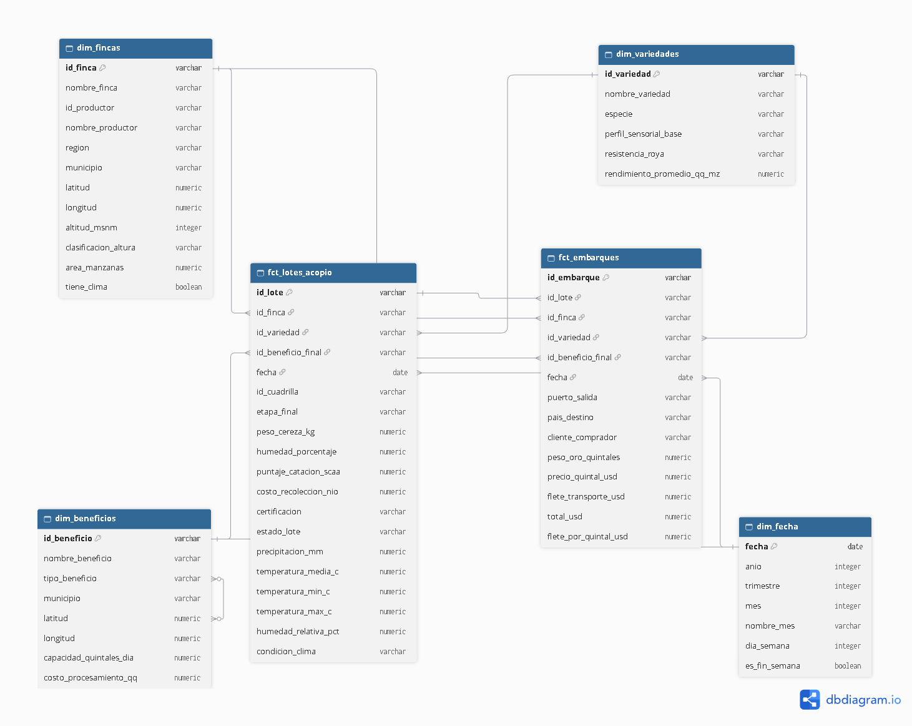

# De los datos a la decisión — Caso D: Cooperativa El Volcán

Proyecto integrador (UNAN-Managua, Ciencia de Datos). Caso: **café de exportación**.
Este repositorio contiene la parte de **Bases de Datos Analíticas**: el modelo en estrella, las transformaciones en dbt y sus pruebas de calidad. Las demás materias (Estadística II, Métodos Numéricos, Optimización) consumen las tablas `marts`.

**Autora:** Karla González

## Arquitectura

```
PostgreSQL (Azure) · base raw · esquema public      ← datos transaccionales
        │
        ▼  dbt: staging (vistas)  → esquema public_staging
        ▼  dbt: marts   (tablas)  → esquema public_marts   ← modelo en estrella
```

## Modelo en estrella





| Tabla | Tipo | Granularidad |
|---|---|---|
| `fct_lotes_acopio` | Hecho | 1 fila por lote de acopio (2,459) |
| `fct_embarques` | Hecho | 1 fila por embarque de exportación (1,883) |
| `dim_fincas` | Dimensión | 1 fila por finca (incluye región, altitud y clasificación de altura) |
| `dim_variedades` | Dimensión | 1 fila por variedad de café |
| `dim_beneficios` | Dimensión | 1 fila por beneficio (capacidad y costo de procesamiento) |
| `dim_fecha` | Dimensión | 1 fila por día (año, trimestre, mes, día de la semana) |

## Decisiones de diseño

- **Beneficio final de un lote:** es la última etapa de procesamiento (por `fecha_inicio` descendente, con `id_proceso` como desempate). 7 lotes no tienen procesamiento registrado y quedan sin beneficio final.
- **Clima:** la tabla de clima solo cubre la región **Jinotega**; por eso solo 928 lotes tienen datos de precipitación y temperatura. Se une por fecha y región.
- **Clasificación de altura** (`dim_fincas`): ≥ 1,200 msnm "Estrictamente Altura (SHG)", ≥ 900 "Altura (HG)", el resto "Estándar Central".
- **Flete:** es fijo de 18.50 USD por quintal; `flete_por_quintal_usd` se calcula como flete ÷ quintales de oro.
- **Total del embarque:** `total_usd = peso_oro_quintales × precio_quintal_usd + flete_transporte_usd` (verificado en los 1,883 embarques).
- **Destino y puerto:** todos los embarques salen por Puerto Corinto hacia Estados Unidos.
- **Cuadrillas:** no se modela una dimensión de cuadrillas; `id_cuadrilla` se conserva como atributo en `fct_lotes_acopio`.
- **Subastas especiales:** no se cargaron al esquema `raw`.
- **Certificación:** el valor "SHG" aparece como categoría en el campo `certificacion` de origen, aunque en realidad es un grado por altura; se conserva tal como viene.

## Pruebas de calidad (dbt)

52 pruebas, todas en verde (`PASS=52 WARN=0 ERROR=0`):

- **48 genéricas** (`unique`, `not_null`, `relationships`) en staging y marts.
- **4 de reglas de negocio** en `dbt/tests/`:
  - `valida_peso_cereza_positivo`: el peso de cereza de cada lote es mayor que cero.
  - `valida_rangos_calidad_lote`: humedad y puntaje de catación entre 0 y 100; costo no negativo.
  - `valida_total_embarque_consistente`: el total del embarque coincide con peso × precio + flete.
  - `valida_embarque_posterior_al_corte`: ningún embarque ocurre antes de la fecha de corte de su lote.

## Cómo reproducirlo

Variables de entorno requeridas: `PGHOST`, `PGUSER`, `PGPASSWORD`, `PGPORT`, `PGDATABASE`, `PGSCHEMA`, `PGSSLMODE`.

```bash
cd dbt
dbt run  --profiles-dir .
dbt test --profiles-dir .
```

Probado en una máquina virtual Ubuntu con dbt-core 1.12.3 y dbt-postgres 1.11.0.

## Estructura del repositorio

```
dbt/            proyecto dbt (models/staging, models/marts, tests/)
scripts/        scripts de análisis
Output/         resultados y gráficos generados
migrations/     migraciones de la base
database_diagram.png
requirements.txt
```

## Estado

- [x] Modelo en estrella y diagrama
- [x] Transformaciones staging → marts en dbt
- [x] Pruebas de calidad de dbt
- [ ] Dashboards descriptivos (en definición con el docente)